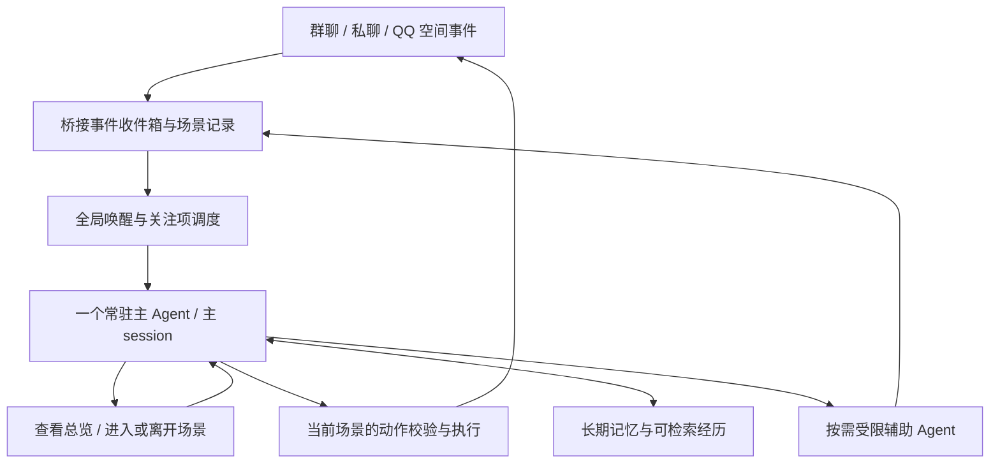

# 统一主体与多场景活动：开发需求文档

状态：v1.0，定稿审查版。已完成文档一致性审查；用户已确认的行为与建议默认设计分别标明，供全文审阅。技术验证尚未执行，不代表实现完成或生产迁移授权。

日期：2026-10-28。运行代码核对基线：`3c794eb`；文档审查基线：`8720ebc`。本轮仅修改文档，不修改运行代码、配置、会话或数据。

配套：[一致性审查记录与技术验证清单](UNIFIED_AGENT_VALIDATION_PLAN.md)。其中的通过条件均为后续验证目标，不是已通过的测试。

后续进展：首轮接口核对及隔离验证见 [P1 技术报告](UNIFIED_AGENT_P1_REPORT.md)。下文保留需求定稿时的目标与阶段说明，实际验证范围以报告为准；统一模式仍未实施。

## 1. 要实现的体验

大肥鱼是一个持续的主体。群聊、私聊、QQ 空间是它活动的不同场景，不再分别拥有各自决定行动的常驻聊天 Agent。

它能在不同场景之间自主切换关注点：闲聊、观察、主动发起话题、追问、发空间动态、评论、想起某个人并找他聊天。用户交代事情只是其中一种情形，不要求所有活动先登记为任务。

典型体验：私聊里聊到一件事，它联想到某位群友，自主进入群聊询问；没有回复时可以先去空间看看；相关回复到来后再回来接话，也可以回到私聊自然提起结果。整个过程保持同一个人格、连续的意图和已有理解。

### 1.1 用户已经确认

- 写清并确认这一版需求后，再写实现代码。
- 群聊、私聊和空间的主动决策归于同一个主 Agent。
- 取消空间独立的固定周期模型唤醒，由主 Agent 决定何时进入空间；检测评论和 @ 的数据采集与是否调用模型分开。
- 峰期调用 `qq_join_session({ key })` 新进入普通场景时返回错误，提示可以自主休眠；已进入的场景不受此次时间变化影响。其他普通场景的未读不推送给主 Agent，真实管理员私聊仍可唤醒。
- 采用方案 C：主 Agent 统一决定，桥接负责监听，辅助 Agent 按需调用。
- 每次回到主菜单都能看到各聊天窗口的真实未读数；读取或总结默认每批 30 条，不把 30 当作未读总量上限。
- 支持在主菜单直接标记已读、进入场景读未读，以及在主菜单委托子 Agent 总结后标记已读三种路径。
- 同一主体采用一套全局权限，不按聊天窗口设置等级；权限由桥接统一控制，使用 `/permission v1/v2/v3` 管理。v1 为聊天、空间、记忆和总结；v2 增加好友关系操作；v3 增加受限工作区文件操作。新版首次启用默认 v3。
- 主菜单也是操作入口：在具备相应权限时可读写受限工作区文件、添加/删除好友、接受/拒绝好友申请，无需先进入一个聊天窗口。
- 全局等级允许文件能力时，大肥鱼可以自主使用；只有 `ownerQQ` 的私聊和已鉴权控制台能提出文件操作要求或修改权限等级。普通群友和非管理员私聊提出的文件要求均明确拒绝，不能通过换场景或委托辅助 Agent 执行该要求。
- 主 Agent 自主判断多处消息的轻重缓急，避免长期冷落某处；管理员私聊不默认拥有最高注意力优先级。
- 允许它自行判断是否跨场景提起内容，包括私聊内容；不额外设置“私聊内容须逐次允许转述”的门槛。
- 沿用已有跨来源记忆共享意图，不新增群与群、群与私聊、聊天与空间之间的记忆隔离。
- 保留既有人工暂停、峰谷时段计算、白名单、工具开关和受限工作区范围；统一模式的峰期拦截方式采用本轮确认的新进入限制。文件能力允许自主使用，但不接受未授权外部来源发起的文件操作要求。
- 开工前 Git 备份；五小时额度剩余不超过 15% 时做好交接，不开始新的生产维护窗口。

### 1.2 拟采用的默认设计，随全文评审

- 使用固定名称、带场景参数的工具，而非按群号生成工具名称。
- 长期记忆数据库保留；各场景局部记忆逐步整合，不直接删除。
- 正常运行复用一个主 session；只有确认无法继续时，才受控更换物理 session，保持主体状态连续。
- 发布前采用离线验证、禁止发送的演练和可回滚试运行。

### 1.3 第一版范围与规则优先关系

- 第一版必须覆盖统一主体、群聊/私聊/空间、主菜单未读三种处理方式、全局权限、按需辅助、峰期新进入限制，以及原有能力的衔接和可回滚迁移；阶段性交付不能永久省略其中一项却宣称整体完成。
- 不包含改变底层模型、重写 SnowLuma、重新维护 QQ 客户端、给每个窗口设置权限档位，或为了统一主体删除历史数据。
- 本文描述的是新统一模式。旧二代模式在迁移前继续按现有代码运行，不因文档定稿自动改变行为。
- “可用”必须同时满足：主体账号有效、已准入、人工未暂停、全局等级允许、工具/资源规则允许，以及该操作所需的场景或委托资格。等级高不是绕过其他条件的总豁免。
- 普通未读总览、其他场景通知和主菜单总结，默认指低谷或关闭峰谷休眠的情况；峰期以 U-07b 为准。管理员唤醒资格不等于强制打断当前活动的注意力优先级。
- 管理命令由桥接直接处理，不依赖主 Agent 正在思考或已被唤醒；文件操作和社交动作仍须遵守人工暂停。读取人工控制台状态不等于向主 Agent推送未读。

## 2. 术语及边界

| 名称 | 含义 |
| --- | --- |
| 主体 | 同一机器人账号的人格、近期经历、关注点、待续话题和长期认识 |
| 主 session | DSH 中承担统一理解、注意力选择和对外决策的会话；正常运行只保留一个活跃主 session |
| 场景 | 一个群聊、一段私聊或当前账号的 QQ 空间；场景本身不是一个 DSH session |
| 总览 | 主 Agent 查看多个场景的未读、活动和待续事项的视图，不是另一个人格或 session |
| 辅助 Agent | 临时执行整理、分析或受限操作的工作者；不能独立成为另一个对外聊天主体 |
| 关注项 | 主 Agent 希望以后留意的事情，例如某个人的回复、某个话题后续或稍后再看空间；可以产生于自主想法，无须用户派任务 |
| 活动周期 | 一次唤醒后主 Agent 进行观察、思考、切换场景和行动，最后让出执行或等待新事件 |

“离开场景”只是停止关注，不是退群、删好友、清空上下文或标记全部已读。“记得不同场景的内容”也不意味着把每条消息立即塞入模型上下文。

同一 QQ 账号是一个主体。若今后切换登录账号，主体、凭证、场景状态和待处理动作必须隔离，不能沿用上一个账号的执行权限。

## 3. 架构方案比较

| 方案 | 工作方式 | 优点 | 主要代价 |
| --- | --- | --- | --- |
| A：保持每个聊天一个 Agent，增加协作 | 各会话继续独立行动，互传任务或记忆 | 改动较小，能并行处理 | 决策仍然分散，不满足本次整体体验目标 |
| B：单一主 session，每场景常驻观察子 Agent | 主 Agent 切换场景，子 Agent 等待、筛选消息并回报 | 接近用户最初构想，观察可以有语义理解 | 大量子会话的生命周期、工具权限、重复唤醒和模型消耗；单纯收消息没有必要调用模型 |
| C：单一主 session，桥接收集事件，按需调用辅助 Agent | 消息接收和等待由桥接完成，主 Agent 统一选择场景及行动 | 保留统一主体；等待不消耗模型；便于重启恢复和去重；子会话数量不随场景数量必然增长 | 需要重做全局调度、场景权限及主 session 恢复机制 |
| D：完全单一 session，所有聊天消息不断直接追加 | 不区分关注场景，所有事件都进主上下文 | 概念最简单 | 热群淹没其他场景，上下文快速膨胀，压缩及路由恢复困难 |

**已确认选择 C。** B 中需要理解的观察工作按需保留，不要求每个群常驻一个子 Agent。子 Agent 的工具、异步回报和回收机制仍须技术验证，不能直接假设现有工具可安全继承。

主 session 负责“想什么、关注哪里、说什么”；桥接负责“消息有没有到、动作发往哪里、权限是否有效、是否已经执行”。桥接不代替模型判断一段普通聊天是否有趣。

## 4. 功能需求

### U-01 统一主体与连续意图

- 所有已准入群聊、私聊和空间共用一个主 session 的人格及主动决策。
- 主 Agent 能记住自己刚在其他场景做了什么、为什么切换、之后还想做什么。
- 进入另一场景不创建新的聊天人格，不要求重述整个人物关系。
- 可以自行选择观察、参与、离开、稍后回来；不强制每次唤醒发言，不要求一条消息对应一次回复。
- 保留现有角色卡和人格编辑能力，不在迁移时重新编写或覆盖用户角色内容。

### U-02 场景总览与切换

- 总览可查询已准入场景、未读数量、最近活动、明确找自己的消息、关注项命中和待续话题。
- 默认展示有界摘要及索引；允许翻页、按人或场景查找，不因总览展示范围有限而丢弃其他场景。
- 进入场景返回可信场景标识、名称、当地时间信息、相关上下文、未读、参与状态和可执行动作。
- 切换后仍处于同一个主 session；离开返回总览，后续可直接进入另一场景。
- 主 Agent 可主动进入安静但有兴趣的场景，不局限于被 @ 或等待用户派任务。
- 空间作为独立场景纳入总览，支持浏览、发布、评论、回复、@，其动作格式可与聊天不同。
- 总览不是禁用工具的空白状态；全局权限允许的账户级操作和文件操作可在总览执行，不需进入管理员私聊来“取得权限”。

#### U-02a 主菜单的未读展示

- 每次 `qq_quit_session` 回到总览时，直接返回最新未读快照，不要求主 Agent 再额外调用工具才知道哪里有消息；主 Agent 也可主动刷新总览。
- 峰期为上述展示规则的明确例外：主 Agent 的菜单不展示其他普通场景的新未读条数、预览或提醒，仅说明这些场景处于峰期休眠；管理员私聊仍可见。普通未读仍在后台保存，低谷恢复真实计数。人工控制台不等于主 Agent 菜单，仍可显示运行状态用于管理。
- 各聊天窗口显示场景名称与标识、真实未读总数、最新消息时间以及相关提醒，例如有人 @、关注项命中。无未读显示 0。
- 30 是默认读取/总结批量，不是计数封顶。若某群有 85 条未读，应显示 85，按默认批量可分为 30、30、25 条处理。
- 场景很多时允许分页，但需明确总场景数、未展示场景数和查询入口；不得把首屏误表示为全部窗口。
- 主菜单数字是带时间和版本的快照。新消息入库更新计数；旧快照不能授权清掉之后的新消息。
- 空间也展示未读活动，但分别标注动态、评论/@ 等计数类别，不能把评论误称为聊天消息或反复统计自己的动态。
- 新架构按持久化事件与已读状态统计实际待处理消息，不因一次返回量有限而截断积压。旧版本已经从未读队列淘汰的消息不能伪造为完整未读历史；迁移时明确可恢复范围。

#### U-02b 三种未读处理方式

| 路径 | 行为 | 已读语义 |
| --- | --- | --- |
| 在主菜单直接标记 | 主 Agent 选择一个或多个窗口，将菜单快照所覆盖的未读标记已读，无需进入 | 允许主动略过；记录为略过，不伪称逐条看过或已经回复 |
| 进入场景阅读 | 进入后调用未读读取工具，默认从最早未读按每批 30 条连续读取 | 读取本身不自动标记；主 Agent 按已展示范围明确确认 |
| 在主菜单委托总结 | 不进入目标场景，给子 Agent 一批指定未读材料，接收总结后确认已读 | 只允许确认该批已成功交付总结的范围，不能把整个窗口剩余积压顺带清空 |

- 主菜单标记使用服务器生成的快照范围或等效凭证；不接受模型自行猜一个最大序号来清除未展示的新消息。该入口不同于“读过正文后确认”，因此不得直接复用一个声称已阅读全文的回执。
- 直接标记后原始消息仍可按历史查询，且不生成回复成功记录。批量标记逐窗口返回实际影响条数和剩余未读数。
- 子 Agent 每批默认最多处理 30 条未读；85 条积压只总结首批并确认后，仍有 55 条未读。主 Agent 可以决定继续总结、进入聊天或直接略过其他消息。
- 子 Agent 的读取授权绑定目标场景和明确消息集合，不需要主 Agent 切换当前场景，也不能获得该群的发送权限。
- 主菜单快照、已展示消息回执和总结委托是三种不同用途的资格：前者允许明确略过，后者允许确认对应已展示/总结范围；它们都不授予向目标场景发消息的能力。不能一律要求“当前场景相同”而使主菜单两条路径失效。
- 总结返回关联消息范围、核心话题、直接找机器人的消息、待回答问题及理解不确定处。主 Agent 可据此进一步查原文、进入场景或选择不参与。
- 总结成功且结果已可靠交付主 Agent 后，主 Agent 才能确认该批已读；子 Agent 不自行扩大已读范围，也不直接修改主 Agent 的关注场景。
- 失败、超时、结果丢失或只完成部分批次时，不自动清空未读；部分成功只允许确认明确完成的部分，重复确认必须幂等。
- 处理期间到达的新消息独立保留。例如菜单显示 30 条，期间又来 5 条，确认旧快照后仍应有 5 条未读。
- 已有不连续的确认范围时，不能仅靠一个最大序号跳过中间未读；实现须记录范围或保持无缺口的确认顺序。
- 总结属于模型调用，继续遵守峰谷、人工暂停和账号/场景权限；从主菜单发起不构成管理员私聊豁免。
- 快照/委托在真正执行时重新检查权限。峰前取得的其他场景快照，不能在峰期继续用于读取、总结或批量略过该隐藏场景。已经开始的辅助总结可以完成计算，但结果若属于届时不应展示的其他场景，应保存并延迟递送，不能自动标记已读或打断主 Agent；低谷再交付后由主 Agent确认。

当前实现核对：`qq_get_unread_messages` 默认返回 30、单次最大 100；未读队列另由 `socialV2.context.unreadLimit` 控制，当前本地配置为 120，超过会淘汰较早队列项。新版不能沿用“单次读取条数等于未读总数”的假设；本段是行为需求，不修改当前配置。

### U-03 自主注意力与打断

- 多处同时来信时，主 Agent 结合关联程度、紧迫性、@、等待时长和自己的关注项选择先处理哪里。
- 不设置“管理员一来信就必须抢占”的产品规则；管理权限优先级不等于注意力优先级。
- 桥接保留未被处理的事件，并在当前允许通知的范围内提示被多次推迟的场景；峰期隐藏范围的等待状态先保存，低谷再呈现。允许主 Agent 决定继续潜水，不能静默丢掉它们。
- 忙碌期间新事件只入队、合并可合并通知，不为同一主体启动并发思考回合。
- 在工具返回、当前动作完成或下一次活动周期等安全边界，向主 Agent 提供新事件。默认不为了普通新消息取消正在执行的发送或文件操作。
- 若 DSH 不支持在运行中安全追加提醒，先使用回合边界递送；不得以“支持即时打断”作为未经验证的承诺。
- 收件后主 Agent 空闲时，桥接调度开销目标不超过 2 秒（模拟健康链路）；模型响应时间、网络中断、暂停或峰期不计入该目标。忙碌时不承诺固定响应时限。
- 不新增自主发言次数、跨场景转述次数或子任务业务次数上限。并发、输入体积和批量大小属于稳定性控制，须与行为限额区分并可观察。

### U-04 等待、潜水与唤醒

- 等待某个场景的回复不能阻止当前符合唤醒资格的其他场景通知主 Agent；峰期仅保留 U-07b 允许的来源。
- 全局等待覆盖所有符合唤醒规则的场景及到期关注项；单场景短暂等待只用于当前对话的补充消息合并。
- `quietMs` 的现有 12 秒硬上限继续保留，不得在统一模式重新引入数分钟静默合并。
- 长时间等待通过保存关注项和让出模型执行完成，不维持一个模型回合或一个子 Agent 永久挂起。
- 每个场景原有潜水、有限睡眠、无限睡眠及唤醒偏好保留；主 Agent 的主动选择仍服从现有允许主动活动的语义，不把迁移当作重置偏好的机会。
- 全局等待、当前场景、场景唤醒偏好分别保存。回合结束、短等待结束或让出执行不隐式调用 `qq_quit_session`；是否还在一个场景中由显式切换及有效性记录判断。
- 被 @、评论、提问等来源仍可形成候选事件；它们不是消息正文自行声明的系统权限。
- QQ 空间自己的动态默认已读；别人评论和明确 @ 仍独立触发关注，不因自己发了一条动态反复唤醒。

#### U-04a 空间取消独立定时模型唤醒

- 统一模式取消当前“到固定刷空间时间就调用空间决策模型”的路径，不再运行独立 `qzoneAgent.decide` 或创建空间专属决策 session。
- 主 Agent 可在正常活动中自主选择进入空间；也可以主动登记“稍后看看”的关注项，由统一调度处理，不另设常驻空间 Agent。
- 评论、回复及 @ 的接收属于数据采集。上游有可靠推送时用推送，没有时保留必要的只读轮询；轮询不调用模型，不发说说或评论，不把消息自动标记已读。
- 空轮询、发现无关动态或轮询定时器到期本身，不应自动生成新的模型任务。真正符合唤醒条件的新评论/@ 进入全局收件箱，再接受统一调度及峰谷、暂停检查。
- 通知采集只覆盖上游实际支持检测的范围，不承诺能获知所有未读取动态中的 @。具体接口与采集成本在技术验证中核对。
- 暂停或峰期下，允许维持符合原数据采集配置的只读通知接收与保存；人工暂停不能启动模型，峰期按当前场景资格决定是否通知主 Agent。未进入空间时不得借采集启动空间活动；若另行关闭空间采集，则停止轮询。
- 现有 `pollIntervalMs` 的含义需要迁移说明：只能作为采集周期使用，不能沿用为独立模型唤醒周期。旧定时任务和新全局事件路径必须去重。

### U-05 自然的跨场景联系

- 自主提起其他场景的相关经历、找人继续讨论、追问、回到原场景分享结果，都属于基础行为，不限于正式委托。
- 需要稍后跟进时可保存关注项：来源、关联场景、相关人物、依据、意图、状态和可选到期时间；完成、放弃或修正均可由主 Agent 决定。
- 用户确认允许模型自行判断跨场景转述，包括私聊；不额外增加逐次确认。
- 内容在主上下文中共享后，不声称能实现模型层面的严格私聊知识隔离。
- 技术凭据、会话令牌、API Key 继续受现有脱敏与发送拦截保护；允许转述聊天内容不等于允许泄漏凭据或提升权限。
- 对“已发出”“对方已回复”“对方已答应”“结果未知”保持区分，依据真实回执和消息记录判断，不能为了完成叙事编造结果。

### U-06 发送与场景一致性

- 聊天发送、引用、@ 及空间发布/评论等场景动作必须绑定服务器签发的场景凭证，而不是读取一个会被随时改写的全局当前群号。文件和好友关系等全局动作按明确资源或账号目标授权，不受“必须进入聊天”限制。
- 凭证绑定主体账号、场景、进入版本和允许动作；进入其他场景或离开后，旧凭证不能再授权新的动作。
- 场景切换与改变外部状态的动作按明确顺序处理。已实际发出的动作不能被后续切换重新定向或假装撤回；结果必须标注真实执行场景。
- 并发 join/quit 不能各自成功后都留下有效的当前场景。多条发送按实际外部发送逐条检查；切换、暂停或撤权后尚未发出的部分不能继续使用失效凭证，已发送和未发送部分分开返回。
- 一个工具调用失败、超时或返回后，主 Agent 均能识别它发生在哪个场景。
- 查看历史、查看未读、标记已读、发送成功分别记账；进入或退出场景不自动消费全部未读。
- 不重复发送有成功回执的动作；结果未知时保留状态并核对，不能通过换编号自动重发。外部接口不支持幂等时，不宣称具备端到端“恰好一次”保证。
- 保留原有文本、引用、@、多条发送、表情、语音、图片等工具能力及对应权限。
- 场景凭证解决聊天或空间动作发往哪里，不定义不同窗口的权限等级；账号级关系操作和文件操作使用明确的账号/资源目标，不依赖当前聊天场景。

### U-07 峰谷、人工暂停及管理员权限

- 人工暂停优先级最高。主 session、辅助 Agent、空间和后台整理都不能借场景切换恢复自动活动。
- 峰期禁止新进入普通场景；已经合法进入且尚未离开的场景继续正常活动，包括后续对话轮次。管理员私聊可随时进入及唤醒，群内管理员发言不构成新进入豁免。
- 管理员唤醒不改变其他普通场景的准入状态。切到管理员私聊或返回主菜单后，原普通场景视为已离开，峰期再次进入必须拒绝。
- 这一条明确替换原来的“峰前仅允许完成当前轮次”要求：峰前进入的群聊可能在整个峰期持续活动，直到主动离开、身份/权限失效或人工暂停；它不是全局高峰零普通推理的策略。
- 高峰期间仍记录普通场景消息，低谷恢复时按原偏好提供候选，不能集中重复轰炸。
- 白名单和工具开关实时生效；好友准入、主动申请、删好友及实际退群继续沿用各自现有规则，不因合并主体自动开放。
- 现有受限 Filesystem 能力必须保留，并允许从主菜单操作。所在窗口不作为授予或收回文件能力的条件；进入管理员私聊也不会自动提升全局等级。
- 先前草案把文件执行固定绑定管理员独立聊天环境的设计不再作为既定方案。全局权限开启后，大肥鱼可以自主发起受限文件操作，不要求每次都先取得一条管理员私聊指令或逐次确认。
- 外部文件请求只接受可信 `ownerQQ` 私聊或已鉴权控制台；普通群友和非管理员私聊要求读取、修改、创建、删除文件或调用文件工具时，必须明确拒绝且不执行。管理员在群中发言也不取得管理员私聊的授权；拒绝表达由主 Agent 自然组织，不泄漏路径、凭据或文件内容。
- 同一未授权请求被引用、转述、记入关注项、等待以后处理、切到主菜单或交给子 Agent 后，仍保留原请求来源，不能改称“自主决定”绕过拒绝。真正的管理员可以通过可信入口另外提出自己的明确操作要求，但仅看到转发文本不算自动授权。
- 主上下文包含普通群聊内容，不等于全部自主文件行为都禁止。对与群友文件要求无关的真实自主操作仍应允许，不能退回“只有管理员私聊才可使用”的旧限制。
- 文件动作记录发起依据，桥接保留可信消息来源和委托关系；Agent 据此判断是管理员要求、自主行为还是应拒绝的普通用户文件要求。`autonomous=true` 之类的模型字段不能改变真实发送者、全局权限或工作区范围。
- 按用户确认，不另建“证明自主意图”的机制，也不将此证明列为 P1 阻塞项。真实发送者、权限档位、路径和工具入口由程序强制校验；自主与受人要求的语义区分交由 Agent 按规则判断，做常规行为回归即可，不承诺杜绝所有间接诱导。仍保留拒绝普通用户文件要求及允许自主使用的既定行为，不改为仅管理员可用。
- 此规则针对通用文件操作能力；正常聊天记录、共同记忆及状态的内部落盘仍按各自接口规则执行，不因聊天来自普通群友而停止保存。
- 文件工具必须经过桥接可实际控制的入口。可以采用受限执行器或具备等效强制校验的工具实现，不预先要求另建一个文件 Agent。允许范围仍是原有受限工作区，不顺带开放任意磁盘、shell 或任意 MCP 通道。
- 群消息、空间正文或辅助 Agent 输出不能伪造管理员身份或修改全局等级。具体来源校验与执行入口属于开发前验证项；未通过前不得上线统一模式。

#### U-07a 全局权限等级与主菜单操作

- `/permission v1`、`/permission v2`、`/permission v3` 切换整个主体的权限等级，不针对当前群或私聊。已确认能力矩阵如下：

| 等级 | 开放能力（同时服从现有工具开关和资源范围） |
| --- | --- |
| v1 | 聊天、空间、场景切换、未读、记忆与总结等日常社交能力 |
| v2 | 包含 v1，再增加已接入的好友关系操作，包括申请、接受/拒绝申请、删好友，以及原有关系管理中的实际退群 |
| v3 | 包含 v2，再增加受限工作区文件操作；大肥鱼可自主使用，外部文件请求仅接受可信管理员私聊和控制台 |

- 新版首次启用默认 v3。这是能力上限，不自动安装、部署或打开原本禁用的功能；主动申请等上游能力仍须实际可用，空间配额等原有配置继续有效。
- 权限设置持久化。管理员改为 v1/v2 后，重启不能恢复成 v3；状态损坏或读取失败也不能当成首次启用来提权，必须保留原件并停止受影响操作、报告故障。
- 同一个主 session 保持稳定的预设和工具入口；桥接在每次实际调用及排队动作执行前检查当前全局等级。不因为进入、离开聊天或切换等级而重新创建主 session。
- 已具备的全局能力不会因回到主菜单而消失。文件操作明确路径及操作范围；好友操作明确账号、目标 QQ 或申请 ID；聊天发送仍需明确场景，不能把消息发往“主菜单”。
- 主菜单可添加/删除好友和处理好友申请，但不能把未安装或尚未启用的上游能力变为可用；仍沿用既有接口支持范围和动作回执要求。
- `/permission` 不带参数查询等级与能力。修改命令只由桥接确认的 `private:<ownerQQ>` 原始管理消息或已鉴权控制台处理，持久化并记录变更；不作为模型可自行调用的提权工具。普通群友、非管理员私聊、管理员群聊、引用/转发中的命令以及模型或子 Agent 输出均不能修改等级。
- 设置成功须在持久化完成后确认；无效等级、未授权来源或保存失败不能偷偷改变有效权限。查询与变更回执应清楚区分“全局等级允许”和“具体功能因其他设置不可用”。
- 等级降级后，尚未执行的动作必须重新校验；已执行动作保留真实结果。辅助 Agent 的权限不得超过全局等级及本次委托范围，不能通过缓存旧凭证保留已撤销能力。
- 全局等级与人工暂停、峰谷、白名单、工具开关及资源范围共同生效。最高等级不自动忽略其他设置；模型看见某个工具也不等于本次调用一定被允许。
- 本矩阵与来源规则已确认；这一版仍处于需求阶段，尚未在运行程序中实现。

#### U-07b 峰期场景进入规则

全局 v1/v2/v3 决定主体有哪些能力；本节只限制进入新场景和其他场景的事件推送，不引入按窗口配置的权限等级。以下规则替换 v0.6 的“每轮只服务管理员”设计。

本节限制仅在 `peakSleep.enabled` 开启且当前为峰期时生效；关闭峰谷休眠后恢复正常准入、未读展示和调度，人工暂停等独立设置仍有效。

| 峰期请求 | 结果 |
| --- | --- |
| 从主菜单进入普通群聊、普通私聊或空间 | 返回进入受限错误，不改变当前场景 |
| 从已进入的普通场景切换到另一个普通场景 | 返回进入受限错误，仍留在原场景 |
| 继续使用已经进入的场景，或重复请求进入同一当前场景 | 保持原资格，不新发进入凭证；按原唤醒偏好正常阅读、回应及继续后续轮次 |
| 进入真实管理员私聊 | 允许，但仍受人工暂停和其他权限规则约束 |
| 离开普通场景到主菜单，再尝试回去 | 已离开资格失效；再次进入受限 |

- `qq_join_session` 的校验以最终提交场景切换的时间为准；异步准备跨过高峰边界时重新判断。失败不能提前注销原场景或错误推进未读。
- 建议错误码为 `PEAK_SCENE_ENTRY_BLOCKED`，说明“当前处于峰期，暂不能进入该场景。可自主休眠，管理员私聊仍可唤醒”，可附下一次低谷时间。没有新资格变化时不建议立即重试。
- 错误提示只是提供选择，不强制踢出当前场景、不设置人工暂停，也不替主 Agent 修改潜水偏好。主 Agent可继续当前合法场景，或退出并进入全局等待。
- 不仅依赖工具提示：峰期桥接主动递送的事件，只来自当前已进入场景和真实管理员私聊。其他普通场景的新未读、@、关注项命中和到期主动机会均保留在后台，不向主 Agent推送或单独唤醒。
- 主菜单按 U-02a 的峰期例外隐藏其他普通未读，不把后台积压作为继续思考的任务。无当前场景时，普通消息不唤醒主 Agent；管理员仍能唤醒同一个主 session。
- 管理员来信时若主 Agent 正忙，先记录，在现有安全边界提醒，不开启第二个并发主回合。是否立即切换注意力仍由主 Agent 决定；真正进入管理员私聊才改变当前场景。
- 当前场景消息及空间动作核验场景凭证；主菜单略过和辅助总结核验各自的快照/委托范围，并统一复查此时的可见性与峰谷资格。不能跳过 join 向其他普通场景发送，也不能在主菜单处理峰期隐藏的普通未读来绕过限制。低谷仍允许主菜单无需进入就总结或标记。已进入场景的资格不会仅因时间跨入峰期而失效。
- 一轮对话结束、主动让出执行、在原场景等待消息，不算离开；显式 quit、成功切到另一个场景或场景失效才结束原资格。峰期某个已进入群可以延续多轮，不应被旧版每次投递的统一峰期拦截误挡。
- 后台黑话研究、独立记忆整理等另起模型工作的峰期休眠继续保留，不因为某群仍处于已进入状态就自动解除。主 Agent 正常使用允许的现有记忆不等于启动后台整理。
- 主菜单全局文件及好友操作仍遵守已确认的全局等级、来源和资源规则；不再添加 v0.6 中“所有账号级动作都必须关联本轮管理员请求”的建议约束。但这些全局能力不能成为在峰期自行启动新的周期模型活动的理由。
- 桥接保存当前场景、进入代次和有效凭证状态。重启后只恢复可验证的已进入状态，并重新核验账号、白名单及权限；不根据主 Agent 自述恢复资格，不恢复已经离开的场景。无法验证时返回总览，不新授峰期普通场景资格。
- ownerQQ 更新、登录账号变化或白名单变化必须在执行前重验。旧管理员来信不能继续修改权限或提出文件要求；旧账号的在途工作不得作为新账号动作执行。人工暂停可以冻结活动而保留场景记录，恢复时重新校验，不能当作一次新进入或擅自清空未读。
- 低谷边界恢复正常场景准入和未读展示，积压消息按原规则调度，不重复发送、不错误推进已读。已有历史和长期记忆不删除；“不推送其他未读”不代表抹去模型已经知道的内容。

人工暂停仍最高优先，当前场景和管理员均不绕过；可信管理命令可由桥接处理以恢复设置。账号切换、白名单撤销和权限降级也继续即时生效，“已进入”不是这些限制的豁免。

### U-08 主 session、压缩与长期记忆

- 正常运行期间一个账号只有一个活跃主 session，重启后验证并复用。
- 原始聊天和空间事件保存在桥接的数据层；只把当前需要的信息、关注事项和相关记忆送入模型。
- 保留共同记忆数据库及查询能力，减少为跨 session 同步而存在的重复注入；不立即删掉现有记忆接口或历史数据。
- 主 session 压缩后，当前关注、刚做过的动作、未完成话题和等待条件应可从持久化状态恢复。
- 不一次性拼接所有旧 DSH 会话、所有压缩摘要或整个记忆库，以免重复引发超大请求。
- 旧会话局部印象和待续话题按来源迁移并保留出处；冲突项不默默覆盖，不能把推测提升为事实。
- 若主 session 确认无法继续，可受控建立下一代物理 session 并恢复主体状态，旧 session 归档保留。一般断网、代理 502 或结果未确认不触发更换。
- 控制台明确区分“更换主上下文并保留记忆”和“遗忘指定记忆”，不得继续用一个含糊按钮同时清除未读、偏好和长期状态。

### U-09 辅助 Agent

- 允许按需整理经历、分析图片或较长材料、做需要理解的观察；不要求每个场景常驻一个子 Agent。
- 辅助 Agent 默认不能发 QQ 消息、发空间、执行关系操作或自行切换主 Agent 的场景。
- 辅助结果包含来源、关联事件和适用范围，经主 Agent 消化后再行动；不得当作高优先级系统指令。
- 外部事件收集不依赖辅助模型成功。子 Agent 超时或失败不能阻止主 Agent 接收新消息。
- 子任务状态可追踪，完成后归档或回收；重启不能重复提交结果未知的子任务。
- DSH 原生子 Agent 若无法满足工具隔离、异步通知或回收要求，使用桥接管理的受限工作 session 达成同样职责；需要在技术验证报告中明确实际形态。

### U-10 可观察性与人工控制

- 控制台能看见当前关注场景、主 Agent 正忙/等待/暂停/峰期受限状态、未读分布、关注项、辅助任务和异常原因。
- 可以查看某条消息是否已呈现、是否已读、是否已回复，不能仅显示一个混淆的“已处理”。
- 允许人工暂停、恢复、调整场景偏好、取消关注事项，以及在有依据时处理卡住的未知结果；这些动作不清空记忆。
- 上游错误继续只进日志和控制台，不把代理地址、报错栈或会话信息发到 QQ。
- 日志使用关联 ID 串联事件、场景切换及外部动作，不打印敏感令牌。

## 5. 工具接口草案

以下名称是评审用语义，不是已存在的 API，也不是最终协议。

| 工具 | 核心语义 |
| --- | --- |
| `qq_list_sessions` | 获取场景总览；支持查询、排序和翻页 |
| `qq_join_session({ key })` | 进入场景，返回上下文及场景凭证；不新建 DSH 会话 |
| `qq_quit_session` | 回到总览；不退群，不清空数据，不标记全部已读 |
| `qq_get_unread` / `qq_get_recent` | 按凭证获取当前场景消息，结果带真实来源和游标 |
| `qq_mark_read` | 场景内确认已展示范围；主菜单另支持带快照范围的主动略过或带总结回执的确认，不跨场景误推进 |
| `qq_send_message` 等现有动作 | 保留能力，凭证限定目标；工具结果包含实际执行位置和回执 |
| `qq_wait_for_events` | 等待全局可唤醒事件；无事件时允许让出回合，避免长期占住执行 |
| `qq_wait_for_messages` | 当前场景的短等待和补充合并；保留硬上限，不负责全局沉睡 |
| `qq_set_wake_config` | 设置场景唤醒偏好；与全局等待、关注项分别表达 |
| `qq_watch` / `qq_unwatch` | 保存或取消关注项；名称可调整，不将所有聊天强行任务化 |
| `qq_summarize_unread` | 在主菜单委托受限辅助 Agent 总结指定场景的一批未读，返回带消息范围的总结回执；不自动标记已读 |
| `qq_recall` / `qq_remember` | 检索、维护长期记忆，沿用证据关联 |
| 空间工具 | 进入空间后浏览、发布、评论、回复及 @；保留原配额和可见性配置 |
| 文件及关系操作入口 | 按全局权限与明确资源/账号目标执行，在主菜单同样可用，不要求先进入某个窗口 |

固定工具名的理由：新增群或私聊不改变 MCP 工具清单，不需要为每个群重复描述和重新加载。场景可以动态变化，但服务器端授权不能只靠工具名称或提示词约束。

“全局等待”具体采用工具长轮询还是结束回合后事件再唤醒，应由 DSH 协议验证选择；两者都必须满足无忙等、可被有效事件唤醒和重启可恢复。

## 6. 数据与状态要求

开发设计至少明确以下记录，字段和文件名待定：

| 记录 | 需要保存的事实 |
| --- | --- |
| 主体记录 | 机器人账号、主 session ID、代次、当前运行资格及恢复状态 |
| 场景状态 | 场景标识、未读水位、已呈现水位、唤醒偏好、当地上下文、当前进入版本 |
| 事件收件箱 | 原始事件 ID、来源、发生时间、投递状态、已合并范围及关联事项 |
| 关注项 | 自主意图、相关人及场景、依据、提醒条件、待续/完成/放弃状态 |
| 动作记录 | 动作 ID、真实目标、授权范围、开始/成功/失败/未知状态及外部回执 |
| 辅助工作 | 关联事项、允许能力、子 session、输入范围、结果及回收状态 |
| 长期记忆 | 原始经历、事实、印象、共同经历、未完事项、证据和修订记录 |

关注项是执行层状态，记忆中的未完事项是语义背景，二者应关联，不能各自产生重复提醒。看过、已读、已回复、明确忽略是不同状态。

保存采用事务或等效的原子方案；消息入库后才确认处理。崩溃在任意中间步骤时，允许等待核对，不允许静默丢消息或盲目重复发言。

## 7. 迁移、启用与回滚

- 新架构首先作为显式选择的运行策略提供，旧二代模式仍可回退；具体配置命名在实施设计确定，不提前修改生产配置。
- 同一账号同一时刻只能有一个拥有对外发送权的调度器。不能让旧群聊 Agent 与新主 Agent同时回复。
- 切换前保存代码及一致性数据备份；运行中的 SQLite/WAL 采用安全备份方式，不只复制主文件而遗漏 WAL。
- 盘点并保存旧群聊/私聊/空间 session、未读水位、唤醒偏好、记忆、空间已读与配额、未确认动作及关系状态。
- 切换时先禁止旧调度启动新任务，妥善处理在途动作，再交接主导权。不能把取消或超时当作发送一定没有发生。
- 初期保留旧会话和历史，不批量删除；旧会话仅在确认无在途工作、切换完成后归档。
- 迁移记忆分批、可重入、带来源，不在首个提示中灌入全部历史。
- 回滚先收回新调度器的发送权，再把试运行期间新增事件、已读水位及发送回执衔接回旧模式。不能简单恢复旧备份而重发已经完成的动作。
- 上线前列出需要重载的桥接、DSH profile/MCP 和辅助配置。是否需要重启 DSH 依据实际部署能力确定；不得在文档阶段擅自重启。
- 现有空间发布上限、间隔和可见性按当前配置继承，不因新架构恢复成历史默认值。
- 原生好友申请的“代码已存在”与“生产已启用”分别记录；本工程不附带修改 QQ 客户端或开启尚未启用的能力。

## 8. 验收场景

自动化部分使用模拟时间、模拟 QQ/DSH 和临时状态。真实外部动作只使用用户指定且获准的测试对象；不能用真实群自动刷屏验收。

除明确指定峰期、暂停、其他权限等级或故障的用例外，默认条件为低谷（或关闭峰谷休眠）、未人工暂停、v3、账号与目标准入有效、对应上游能力已在隔离环境模拟可用。A 编号是验收目标，不是已经通过的实现测试。

| 编号 | 场景 | 必须观察到的结果 |
| --- | --- | --- |
| A01 | 群、私聊、空间依次进入 | 同一主 session，场景变化清楚，无新常驻聊天 Agent |
| A02 | 未接任务，自主从私聊话题联想到群友 | 能选择进入群聊并自然接话，不要求先建正式任务 |
| A03 | 在群里等待时私聊有相关新消息 | 消息入全局收件箱，主 Agent可在安全边界改换关注，不被单群等待锁住 |
| A04 | 热群持续来信，另一场景等待较久 | 热群通知可合并；其他场景不丢失，等待时长可见；明确潜水决定保留 |
| A05 | 私聊内容在群里被自然提起 | 符合用户允许自主转述的选择；不额外逐次审批，不泄漏技术凭据 |
| A06 | 发往 A 的动作进行中，随后切到 B | 动作只能发往 A；结果标明 A；旧凭证不能发起新的动作 |
| A07 | 普通群友要求读取或修改文件，或声称执行 `/permission v3` | 明确拒绝文件要求、不执行文件动作；场景切换及消息声明均不能提升权限 |
| A08 | 真实管理员私聊要求工作区文件操作 | 仍能完成原有受限文件能力，结果回到真实请求范围 |
| A09 | 高峰其他未进入的普通群 @、空间评论、后台学习 | 不推送普通未读、不启动对应模型活动；事件保留，当前已进入场景单独按其资格处理 |
| A10 | 高峰管理员私聊，模型试图顺便进入其他群 | 管理员私聊正常；进入其他普通场景返回错误 |
| A11 | 人工暂停后进入低谷或收到回复 | 保持暂停；恢复后不丢事件、不重发已完成动作 |
| A12 | 入站后、模型投递前、发送后分别崩溃 | 可恢复真实状态；未知结果保守核对，不盲目重复发送 |
| A13 | 创建主 session 的响应丢失 | 重试沿用同一持久化创建身份，不积累重复主 session |
| A14 | 上下文压缩或受控更换主 session | 人格、关注项、已读偏好和长期认识继续可用；历史保留 |
| A15 | 进入、查看、离开场景但不标记已读 | 未读水位不错误推进，跨场景水位互不污染 |
| A16 | 辅助 Agent 返回恶意指令或失败 | 不改变权限，不自行发送；主 Agent仍可接收事件 |
| A17 | 自己发空间动态，别人随后评论或 @ | 自己动态已读，评论和 @ 保留为独立事件，不循环唤醒 |
| A18 | 多次延期、收到无关回复、收到明确答复 | 不把无关发言当成答复；意图和结果可继续、修正或结束 |
| A19 | QQ/DSH 断连、上游 502、413 | 明确等待或恢复状态；普通错误不新建 session、不向 QQ 输出技术报错 |
| A20 | 试运行后回滚旧模式 | 只有一个发送权拥有者，试运行期间事件不丢、已发消息不重发 |
| A21 | 删除好友、退出群或从白名单移除 | 旧场景凭证失效，待执行动作重新校验，不自动重新加回 |
| A22 | 长消息、媒体、海量历史 | 有界输入和可检索原始数据，不直接拼接整个历史造成超大请求 |
| A23 | 等待时持续追加消息 | 保留 12 秒静默合并硬上限；主 Agent可看到新事件并自行决定回应 |
| A24 | 回到主菜单时某群有 85 条未读 | 自动返回 85 的快照，不封顶为 30；默认可按 30/30/25 连续读取 |
| A25 | 主菜单显示 30 条后新增 5 条，再直接标记 | 仅原快照 30 条被标记，5 条保持未读；日志显示主动略过，历史不删除 |
| A26 | 不进入场景，在主菜单总结 85 条中的首批 30 条 | 当前场景不变；收到总结并确认后剩 55 条，子 Agent不能自行发送或清掉其他未读 |
| A27 | 总结失败、部分成功、结果丢失或重复确认 | 未完成消息仍未读；成功范围只确认一次，不发生跳跃水位误读 |
| A28 | 主菜单批量标记多个窗口，另一个窗口有新消息 | 每个窗口按各自快照范围处理，返回逐窗口结果，不凭全局最大序号标记 |
| A29 | 具备文件权限时自主回到主菜单执行受限文件操作 | 无需新管理员指令或逐次确认；按全局等级、发起依据及路径范围检查 |
| A30 | 主菜单添加/删除好友或接受/拒绝申请 | 使用明确目标及当前账号执行，无需先进入目标私聊；上游能力及原有准入规则仍有效 |
| A31 | 切换场景后查询权限，或降级后执行排队动作 | 场景切换不改变全局等级；降级后超出权限的待执行动作被拒绝，无需重建主 session |
| A32 | 群友要求文件操作后，改为引用、延后、切主菜单或委托子 Agent | 来源仍被保留，不能以“自主操作”执行同一要求；只伪造自主标记不能取得授权 |
| A33 | 看过普通群聊后，主 Agent 自主处理与群友文件要求无关的工作区内容 | 全局权限允许时仍可执行；不会因上下文存在群消息而全部禁用文件能力 |
| A34 | 新版首次启用、管理员降为 v1 后重启、权限记录损坏 | 首次默认 v3；重启保留 v1；损坏不能自动恢复 v3 或覆盖原件 |
| A35 | 普通群友、非管理员私聊、管理员群聊或转发文本发送权限命令 | 不修改全局等级；可信管理员私聊和鉴权控制台可以修改并持久化 |
| A36 | 非管理员私聊提出文件要求，管理员私聊提出相同要求 | 前者明确拒绝且不执行；后者在 v3 及资源范围允许时可执行，回到主菜单不失效 |
| A37 | 在各等级尝试聊天/空间、关系操作和文件操作 | 分别符合 v1/v2/v3 能力矩阵；设置 v3 不自动启用关闭或未部署的功能 |
| A38 | 空间采集定时器到期但没有符合条件的新评论/@ | 仅采集数据，没有空间模型调用，不启动主 Agent，也不改变已读或发送动态 |
| A39 | 空间新评论/@ 分别在低谷、峰期、人工暂停时到达 | 事件去重保存；峰期仅空间已合法进入时可按规则递送，人工暂停不启动模型，不创建空间决策 session |
| A40 | 峰期回主菜单并请求总结其他群未读或发空间 | 其他普通未读不展示；不能绕过场景进入限制启动总结或发送；管理员来信仍可唤醒 |
| A41 | 峰期已进入 A 群，尝试进入 B 群失败，随后管理员来信 | join 失败仍留在 A，A 的活动继续；管理员通知可到达，切到管理员私聊后 A 的旧进入资格失效 |
| A42 | 峰前已进入 A 群，峰期继续多轮；之后退出再尝试进入 A | 多轮活动允许；退出后重进返回错误，不限于只完成峰前的一轮 |
| A43 | 主 Agent在菜单因进入受限而等待，其他群持续来信 | 不被其他群未读/提醒重复唤醒；管理员来信能唤醒，低谷再恢复其他场景展示与准入 |
| A44 | 重启发生在仍处于 A 群、已经退出 A 群、或进入记录不可验证时 | 只恢复可验证且仍有效的当前场景；不能通过重启重新授予已退出场景的峰期资格 |
| A45 | join 请求开始于峰前，但异步准备完成于峰期 | 在场景切换提交前复查并拒绝新进入，不注销原场景或推进未读 |
| A46 | 低谷取得 B 群菜单快照或发起 B 群总结，未进入 B 即跨入峰期 | 旧快照不能继续标记隐藏未读；总结完成可保存但不递送普通内容、不自动已读，低谷后再恢复 |
| A47 | 低谷主菜单总结/标记 B 群，同时尝试用同一资格向 B 发言 | 总结和标记按授权范围可用；不能将菜单或总结资格当作发送凭证 |
| A48 | 两个并发切换，以及发送多条消息期间切换/暂停 | 至多一个有效当前场景；未发出的消息不使用失效资格，已发部分保留真实目标和回执 |
| A49 | 峰期在已进入群中结束一轮、等待、再次被当前群唤醒 | 原场景资格保持，按原偏好继续多轮；只有显式退出、成功切换或资格失效才结束 |
| A50 | 排队操作期间 ownerQQ 或登录账号变化 | 旧授权在实际执行前失效，不把旧管理员身份或旧账号动作带给新身份 |

行为质量另做固定场景评审：是否像同一主体、是否自然延续、是否知道刚刚在别处做过什么、是否主动但不过度插话、是否对未知结果诚实。架构可以保证共享状态与权限，不能承诺模型每次都做出同样的社交判断。

## 9. 开发前必须验证的事项

这些是待验证事实，不当作已具备的能力：

逐项执行方法、应留证据、依赖关系和失败后的停止条件见 [技术验证清单](UNIFIED_AGENT_VALIDATION_PLAN.md)。目前所有技术验证均标记为未执行。

1. DSH 主 session 在排队、运行、等待工具及重连状态下，能否安全获得新事件；如何区分已投递和投递结果未知。
2. DSH 子 Agent 的实际工具面、身份传递、异步回报、生命周期和回收。是否采用原生子 Agent不影响单一主体的验收目标。
3. 文件入口能否统一强制校验全局等级、真实身份、工具范围及原有工作区范围，避免直接 Filesystem 或其他执行工具绕过；普通文件请求与自主行为的区分由 Agent 按规则判断，只做常规行为回归，不开展自主意图证明专项。
4. 场景凭证在连续切换、并发工具调用、批量发送、重启及权限撤销时的失效行为。
5. 压缩、模型路由变化和主 session 更换时，哪些状态由 DSH 保存，哪些必须由桥接持久化；不能再次把跨模型压缩状态衔接当作自然成立。
6. QQ 空间工具目前需要的身份、场景、回执与配额，能否统一接入动作通道而保留原功能。

若其中一项不成立，应修改设计或明确缩减本阶段承诺，不能靠放宽安全守卫、取消权限校验或反复生产试错来推进。

## 10. 分阶段交付建议

| 阶段 | 产物 | 进入下一阶段的条件 |
| --- | --- | --- |
| P0：需求确认 | 本文修订、决策记录、验收清单 | 用户确认架构与行为范围；未确认前不写运行实现 |
| P1：协议和权限验证 | 离线模拟及隔离 DSH 验证报告、模块设计、迁移数据契约 | 关键未知项有证据，发送和文件权限方案通过反例测试 |
| P2：统一主体基础 | 主 session、场景状态、全局收件箱、等待和场景工具 | 单一发送权、复用、消息路由和恢复测试通过 |
| P3：自主活动与全能力衔接 | 关注项、空间、长期记忆、原工具和按需辅助者 | 核心行为与原功能回归通过，无必须功能被永久搁置 |
| P4：迁移与验证 | 控制台、迁移/回滚方案、禁止发送的演练及受控试运行 | 新旧交接、回滚和真实小范围验收通过 |

禁止发送的演练不能顺手消费生产未读、改空间已读、消耗发布额度或更新真实动作状态。需要模型验证时使用独立测试状态，明确成本范围。

当前不承诺固定工期。P1 结束后按已验证协议估算剩余工作，不用“再试一次 QQ 维护”代替明确的阻塞项和停止条件。

## 11. 评审决策记录

v1.0 的文档审查已修正术语及规则冲突；这不替代对建议默认设计的全文审阅，也不把技术风险记为已解决。后续若验证导致产品行为改变，先在此记录具体变化再决定是否调整范围。

| 项目 | 当前结论 |
| --- | --- |
| 整体人格、统一主动决策 | 用户确认 |
| 注意力自主分配，不固定管理员最高优先 | 用户确认，2026-10-28 |
| 私聊内容也允许自行判断是否跨场景转述 | 用户确认，2026-10-28 |
| 架构 C：主 Agent统一决定、桥接监听、辅助者按需调用 | 用户确认，2026-10-28 |
| 主菜单返回时显示真实未读数，每批读取或总结 30 条 | 用户确认，2026-10-28 |
| 主菜单直接标记、进入阅读、子 Agent总结后标记 | 用户确认，2026-10-28 |
| 固定场景工具名与参数 | 拟采用默认设计，随全文评审 |
| 保留长期记忆，主 session 允许故障时受控更换 | 拟采用默认设计，随全文评审 |
| 按需辅助 Agent，包括未读总结 | 用户确认；DSH 技术能力待验证 |
| 一个主体采用全局等级，不按聊天窗口分级 | 用户确认，2026-10-28 |
| 主菜单可执行允许的文件和好友关系操作 | 用户确认，2026-10-28 |
| 取消空间独立固定周期模型唤醒 | 用户提出并纳入需求，2026-10-28 |
| 保留必要的空间通知采集，与模型唤醒解耦 | 为保持评论/@ 接收能力的建议实现，随全文评审 |
| 峰期禁止新进入普通场景，已进入场景可继续活动，其他未读不推送，管理员可唤醒 | 用户确认方向，2026-10-28；已替换此前管理员回合限定建议 |
| `/permission v1/v2/v3` 能力划分：社交、增加关系、增加文件 | 用户确认，2026-10-28 |
| 新版首次启用默认 v3，不自动启用关闭或未部署功能 | 用户选择 v3；其余现有配置与部署边界保留 |
| 全局等级允许时可自主使用文件能力 | 用户确认，2026-10-28 |
| 自主文件行为的语义判断 | 用户确认不投入专项证明工程，2026-10-28；由 Agent 按可信来源及规则判断，保留程序权限校验和常规回归 |
| 普通群友和非管理员私聊要求使用文件能力 | 用户确认明确拒绝，2026-10-28 |
| 修改等级和外部文件请求仅接受 ownerQQ 私聊及鉴权控制台 | 用户确认，2026-10-28 |
| 文件操作的强制校验入口或受限执行器 | 具体技术方案待验证，不要求独立文件 Agent |
| 具体界面、配置字段、存储表和 DSH 协议细节 | 后续实施设计；不是本文已实现的内容 |

## 12. 当前代码依据

- `src/bridge.js`：按会话的消息、唤醒、令牌、模型投递、控制台及权限处理。
- `src/mcp-snowluma-safe.js`：当前以会话 key/token 为入口的消息、等待、记忆、空间与关系工具。
- `src/qzone-agent.js`：当前独立空间工作会话；`3c794eb` 增加其持久化复用，统一模式需衔接而非并行启动两个空间决策者。
- `src/shared-memory.js`、`src/shared-memory-worker.js`：经历、长期记忆及受限后台整理。
- `docs/guides/SHARED_MEMORY.md`：当前共同记忆行为与限制。
- `docs/QQ_ADD_BUDDY_MCP.md`：关系能力的代码/生产启用状态应在实际开发前再次核对。

已知基线问题：`test-peak-sleep.mjs` 中“谷期补收有限睡眠被 DSH 拒绝时延后重试”用例仍依赖已取消的 QQ 报错发送定时器；在本次文档之前的代码上可复现失败。实施前需修正测试契约并验证实际重试行为，不能将它混作新架构的通过结果。
